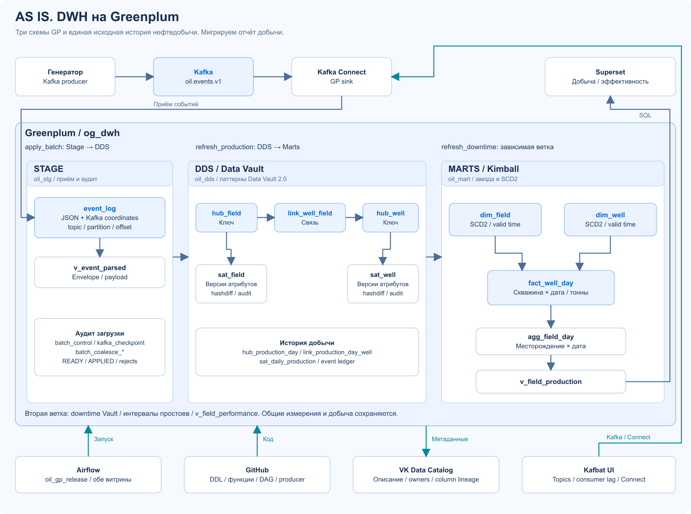

# AS IS / Greenplum

Три физические схемы: oil_stg для приёма и аудита, oil_dds с паттернами Data Vault 2.0, oil_mart с измерениями SCD2, фактом и агрегатами Kimball. Обе исходные ветки используют общий приём и историю.

При переносе выбранные исходные объекты читаются напрямую через Cedrus под стандартными SHARE-lock. GP sink и source DAG приостанавливаются на окно загрузки и сверок; Kafka и Iceberg sink продолжают работу. Обычный SELECT исходного отчёта доступен. Служебные копии источника не участвуют.

Синие стрелки показывают данные и связи моделей, бирюзовые — управление или метаданные. SVG — редактируемый оригинал, PNG — версия для просмотра. Схема описывает архитектуру; сама не создаёт объекты.

